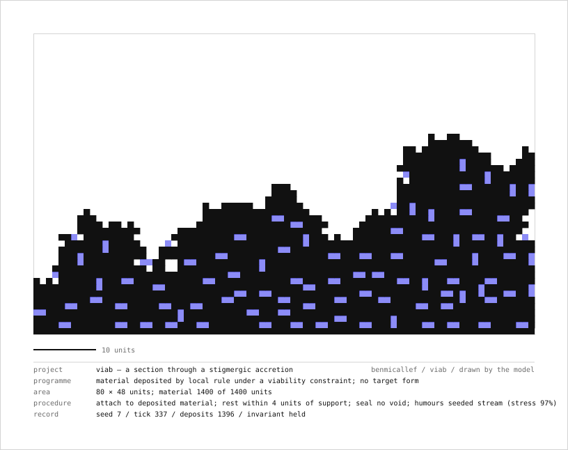
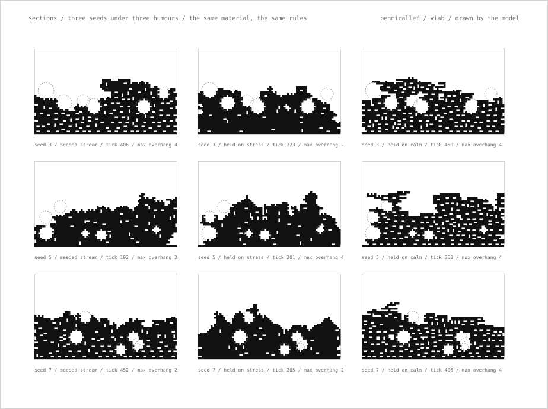
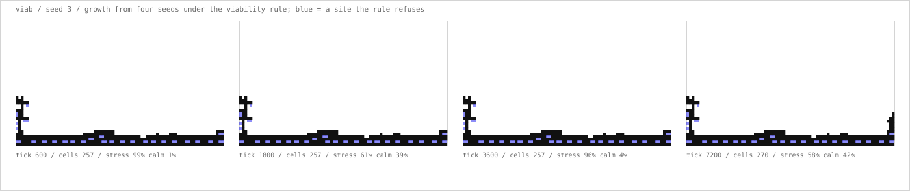

# viab

A browser toy of decentralized, stigmergic construction under a viability constraint — steered by a synthetic stream of inhabitants' *humours*. It borrows its mechanism from termite-inspired swarm robotics and its concept from the architecture of R&Sie(n). It is not a robot, not a building, and not a reproduction of either.

**[▶ Live demo](https://benmicallef.github.io/viab/)**



`node tools/humours-sheet.js` draws nine finished sections, three seeds under three humours — the seeded stream, stress held, calm held — from the same material under the same rules. The difference between the columns is the whole effect of the humours signal.





*One run at four moments. Calm phases reach outward and climb thin; stress phases fill beneath. Blue marks where the cantilever limit refuses a deposit. Drawn by `tools/plate.js` from the model's own grid.*

## What it is

Many simple agents walk the surface of a growing structure on a 2-D lattice. Each one perceives only a small patch around itself, deposits at most one cell per step if local rules allow, then steps to a neighbouring surface cell. No agent ever reads another agent's state. The only thing they share is the structure they are building, so all coordination happens through the material — stigmergy. A deposition is allowed only where it stays *viable*: attached to existing material, supported (on the ground, resting on the cell below, or cantilevered no further than a fixed limit), and without sealing a void. A synthetic humours signal leans the growth — stress toward dense enclosure, calm toward open reach — but never overrides the viability rule.

The result is open-ended. Unlike a blueprint, there is no target form; the structure that appears is a product of the local rules and the humour stream, reproducible exactly from a seed and different for every seed.

## Two lineages, kept separate

**The mechanism is real robotics.** Werfel, Petersen and Nagpal's TERMES system (*Designing Collective Behavior in a Termite-Inspired Robot Construction Team*, *Science*, 2014) showed a team of climbing robots build towers and castles from foam bricks using only local sensing, with no supervisor and no communication between robots — coordination entirely through the shared structure. One honest nuance matters: TERMES is **not** blueprint-free. A user specifies a target structure offline, and a compiler turns it into the local rules that guarantee it. What TERMES removes is the *runtime* foreman, not the plan. This sim drops the target as well: there is no structure to reach, so the growth is genuinely open.

**The concept is speculative architecture.** R&Sie(n) (François Roche, Stéphanie Lavaux, Jean Navarro, with Benoît Durandin) staged *I've heard about…* for the Musée d'Art Moderne de la Ville de Paris / ARC at its temporary venue, the Couvent des Cordeliers, from 7 July to 9 October 2005, and *Une architecture des humeurs* at Le Laboratoire, Paris, from January 2010. These were **unbuilt, exhibited** projects — models, machines, films, a manifesto — proposing a city that grows by "local accretion … not planned in advance," "taking into account viability, i.e. all the varieties of structural constraint," with a Viab that reads inhabitants' speech and chemical signals. Two honesty notes: R&Sie(n)'s own Viab was proposed as a single building machine secreting fibre-reinforced concrete by a contour-crafting process (machines by Stephan Henrich; contour crafting after Behrokh Khoshnevis, USC) — **not** a decentralized robot swarm; their "swarm intelligence" is a figure for citizens as networked political agents. And the humours are a conceptual input that *affects* the construction logic; they are not a validated pipeline from biochemistry to building.

## What I borrowed, what I invented

| From TERMES (real robotics) | From R&Sie(n) (speculative architecture) | Mine, in this repo |
|---|---|---|
| Local rule + stigmergy; no runtime foreman, no inter-agent comms | Open, a-rhythmic, unplanned growth; the word "viability"; the humours idea | The specific deposition predicate and cantilever invariant |
| A structural guarantee from local rules | Form as "uncertain and unpredictable" | The humour coupling and its weights; the 2-D lattice |

## Model and rules

A cell may be deposited at `(x, y)` only when all three hold ([`docs/viab.js`](docs/viab.js)):

- **Attachable** — it touches material that was deposited (`isAttachable`). The floor and the walls bear weight but are not material to build on, so every form grows from one of a few seed cells.
- **Supported** — it is on the ground, rests on a solid cell directly below, or cantilevers no more than `L` contiguous cells from a column that is itself supported (`isSupported`). The lattice's side walls and floor count as solid; the sky does not. Depositing only ever adds material, and each of these conditions is monotonic under adding material, so a cell that is supported when placed stays supported forever. That is how "no floating material" is guaranteed.
- **Non-sealing** — it must not leave any neighbouring void fully enclosed, so the structure stays porous and climbable (`trafficOk`).
- **Not reserved** — the scenario reserves a few chambers for its inhabitants, placed by the seed, and no material goes into them (`isReserved`). Material accretes around them, so a finished section reads as rooms inside a mass; the chambers are the programme.

In the live demo the **viability overlay** tints every attachment site: grey where a deposit is allowed, blue where the rule refuses it (an over-cantilever or a deposit that would strand a void). The humours can be held on stress or calm by the viewer, or left to the seeded stream. Material is finite (1,400 units by default), so a run finishes as a section; **export sheet** downloads that section as an SVG drawing with a title block in the scenario format R&Sie(n) used for every project — programme, area, procedure, record — and a scale bar. The generator's output is a drawing, which is the sense in which this is a generative architecture.

## Determinism and tests

Every random choice routes through a seeded PRNG (`mulberry32`), so a run is a pure function of `(seed, params)`. That is what makes the test suite meaningful — it checks invariants, not screenshots.

```bash
npm test        # node --test, zero dependencies
npm run check   # a headless summary of a few seeds
```

The suite ([`test/`](test/)) pins: the support predicate and the exact cantilever boundary (an overhang of `L` is viable, `L+1` is refused); the attachment and anti-sealing rules; **the headline property — after a full run across thirty seeds, and at every intermediate tick, no solid cell is ever unsupported**; determinism (same seed → identical structure hash; different seed → different); that growth actually happens; termination and agent conservation; and that the humour coupling behaves (stress scores enclosing sites above calm; calm scores cantilever sites above stress).

## Honest limitations

This is a 2-D toy. "Support" is a combinatorial cantilever invariant, a proxy — not statics or finite-element analysis; a real build would need a centre-of-mass or moment check. The humours are a synthetic seeded signal, not real affect or sensor data. The model reproduces neither TERMES nor R&Sie(n); its rules, its humour coupling and its lattice are my own, inspired by both. It says nothing about deployable robots or real buildings.

## Precedents, kept to what is verified

"Viab" is R&Sie(n)'s name for the building machine of *I've heard about…* (2005). The Canadian Centre for Architecture's record of Viab02 (*Une architecture des humeurs*, 2010) glosses the name as viability + variability and describes a secretion-and-weaving machine extruding bio-cement, developed with the USC Robotics Research Lab. The name is borrowed with attribution; the deposition rules here follow TERMES.

Olzweg (FRAC Centre extension competition, Orléans, 2006; joint laureate, the commission went to Jakob+MacFarlane) proposed a robot stacking recycled glass rods, placed by a dispersal script, in random mode over more than ten years, with the software managing the uncertainty of the final form. It is the closest R&Sie(n) precedent for building as an open-ended stacking procedure; this simulation tests one local deposition mechanism and nothing else.

The *neighbourhood protocol* of *I've heard about…* and the deliberately uncertain protocols of *Une architecture des humeurs* are the sense in which this sim's rules are called protocols: local, iterated, with no target form. The Viab existed as prototypes and exhibition apparatus, not as a working robot; nothing here implements Roche.

## Extensions

A 3-D lattice (closer to TERMES), a simplified statics check in place of the combinatorial proxy, and a mapping from the deposition rule to a real climbing-robot instruction set are the obvious next steps.

## Sources

- J. Werfel, K. Petersen, R. Nagpal, "Designing Collective Behavior in a Termite-Inspired Robot Construction Team", *Science* 343 (2014) 754–758. [doi:10.1126/science.1245842](https://doi.org/10.1126/science.1245842)
- R&Sie(n), *I've heard about…*, Musée d'Art Moderne de la Ville de Paris / ARC, at the Couvent des Cordeliers, 2005; catalogue Paris Musées, 2005; essay in *Log* 10, 2006.
- R&Sie(n), *Une architecture des humeurs*, Le Laboratoire, Paris, 2010; Canadian Centre for Architecture, R&Sie(n) project records, fonds AP193.
- R&Sie(n), Olzweg, FRAC Centre extension competition, Orléans, 2006.
- E. Bonabeau, M. Dorigo, G. Theraulaz, *Swarm Intelligence: From Natural to Artificial Systems* (Oxford, 1999) — for stigmergy.

## License

MIT — see [`LICENSE`](LICENSE).
